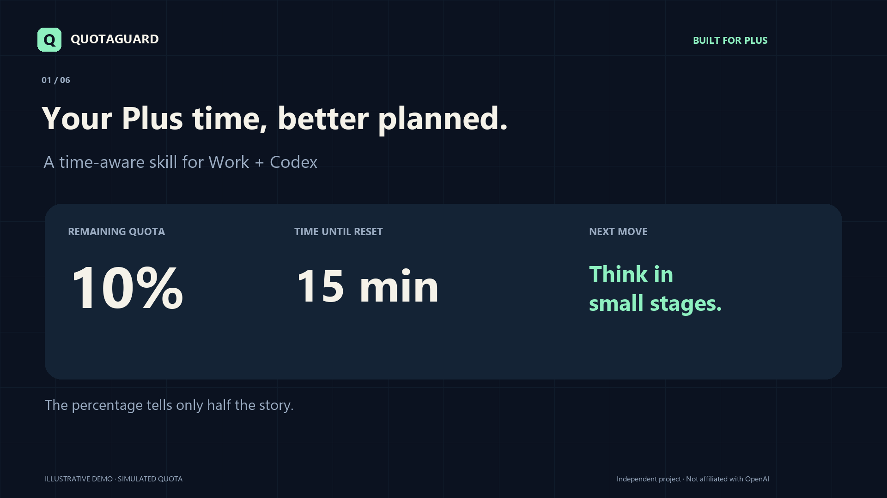

# QuotaGuard Skill

**Give your Plus agent a sense of time.**

A local, open-source skill for ChatGPT Plus users working with Work or Codex.
It reads remaining quota and reset times, then helps the agent choose a sensible
pace for research, documents, and coding tasks.



[Watch the narrated demo](https://github.com/liuguangyu272/quotaguard-skill/releases/latest)

## Why time matters

Both examples have **10% left**. They should not lead to the same plan.

| Quota left | Reset in | Budget | Suggested pace |
|---|---|---|---|
| 10% | 2 hours | 5 percentage points/hour | Tight: smaller stages, core work first |
| 10% | 15 minutes | 40 percentage points/hour | Abundant: useful work that still fits the remaining 10% |

```
hourly budget = remaining quota percentage / hours until reset
```

The default personal reference is **12 percentage points/hour**:

| Budget | Level |
|---|---|
| < 6 | TIGHT |
| 6 to < 12 | CONSERVATIVE |
| 12 to < 18 | COMFORTABLE |
| >= 18 | ABUNDANT |

This is a planning heuristic, not an OpenAI rate limit or measured burn rate.
Absolute remaining quota and weekly limits still matter. A near-zero reset
countdown can produce a large ratio without creating any additional quota.

## What it does

- **Makes quota actionable:** reports both allowance and reset time before substantial work.
- **Paces long tasks:** guides stage size and optional exploration using time-aware budgets.
- **Keeps weekly constraints visible:** a healthy short window does not erase a low weekly allowance.
- **Supports continuity:** asks the agent to write a concrete resume note at useful milestones.
- **Fails honestly:** unavailable data stays unknown; old log snapshots are clearly marked.
- **Stays lightweight:** Python standard library only; no API key or separate paid API usage is required by this helper.

## Install

Requirements: **Python 3.11+**, a local **Codex installation signed in with your ChatGPT account**, and a skill-capable desktop/CLI environment that can execute local commands. Windows is live-tested; macOS/Linux portability is intended but has not been live-tested for this release.

```sh
git clone https://github.com/liuguangyu272/quotaguard-skill.git
cd quotaguard-skill
python install.py
```

Use `python3` on systems where that is the Python 3 command. The installer copies
the self-contained skill into `$CODEX_HOME/skills/quotaguard`, or
`~/.codex/skills/quotaguard`. It refuses to overwrite an existing installation.
For an existing QuotaGuard skill, back it up or rename it first.

On your next turn, try:

```text
$quotaguard Check my remaining quota and reset time, then help me plan this task.
```

Automatic selection is enabled for substantial tasks, but is not guaranteed on
every message. Explicit invocation is the easiest first test. If the skill is
not listed yet, refresh the skill list or start a new session.

To try the reader before installing:

```sh
python skill/quotaguard/scripts/query.py
```

If Codex cannot be found, set `QUOTAGUARD_CODEX_COMMAND` to the actual executable
path (a path, not a shell command with arguments). Windows npm installations
under the standard AppData directory are detected automatically.

## Data and boundaries

The helper starts a short-lived local `codex app-server`, initializes the
protocol, and calls `account/rateLimits/read`. Codex owns authentication;
QuotaGuard does not open `auth.json`. The query helper prints JSON and does not
write project files. Resume notes are written separately by the agent.

The reading belongs to the account/workspace used by local Codex. Check that it
matches the one you use in the App. The default is live-only. An optional
`--source session` reads local log snapshots and labels pacing UNKNOWN.

OpenAI currently documents shared Work/Codex usage and five-hour windows for
Plus. See [official pricing](https://learn.chatgpt.com/docs/pricing) and the
[App Server protocol](https://learn.chatgpt.com/docs/app-server). Availability and
quota structures can change. This does not read every ordinary ChatGPT feature's limit.

**No extra quota, no limit bypass, no automatic model switching, and no
guaranteed savings.** This skill guides an agent; it is not a hard enforcement
proxy or a background scheduler. Necessary verification remains part of the task.

## Evidence

Run the deterministic checks:

```sh
python -m unittest discover -s tests -v
```

The tests cover time-sensitive decisions, all four boundaries, low weekly quota,
unknown and expired resets, stale fallback, zero quota, and installation into an
unrelated directory. See [validation notes](docs/validation.md) for the scope of
the evidence. Promo examples use **simulated values**, not a recording of a
customer account. No productivity or cost-saving benchmark is claimed.

## Credits

Built on the MIT-licensed quota readers from
[LUMOSSES/QuotaGuard](https://github.com/LUMOSSES/QuotaGuard), with a portable
English skill and the 12-point hourly pacing policy. See [NOTICE](NOTICE.md).
Independent community project; not affiliated with OpenAI.
